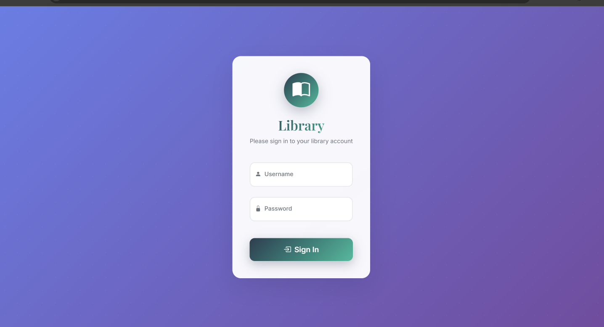
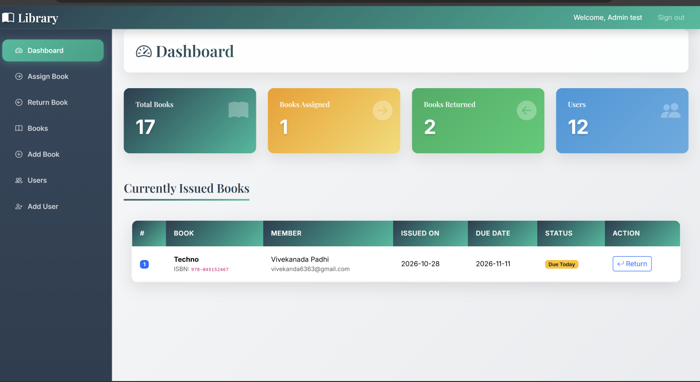
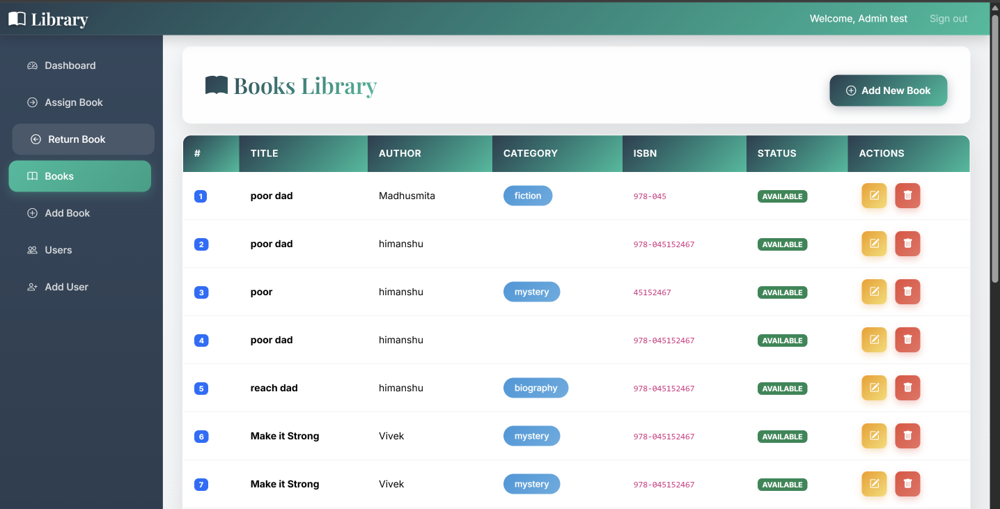
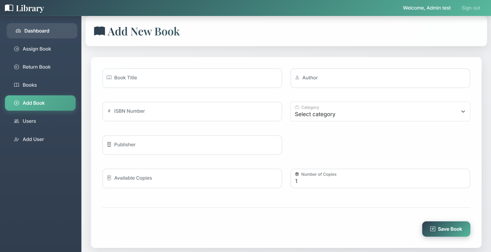
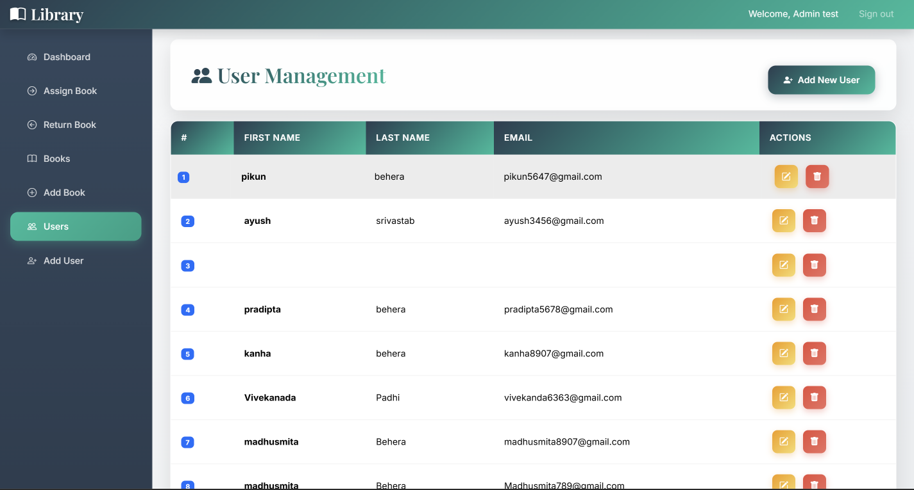
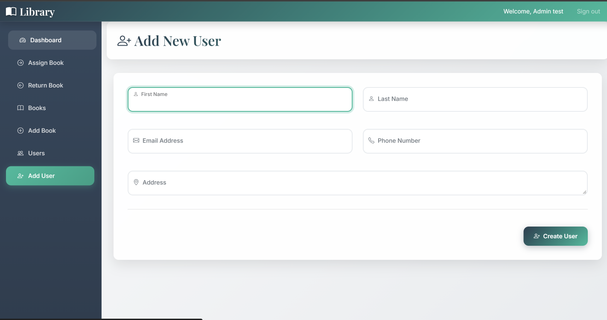
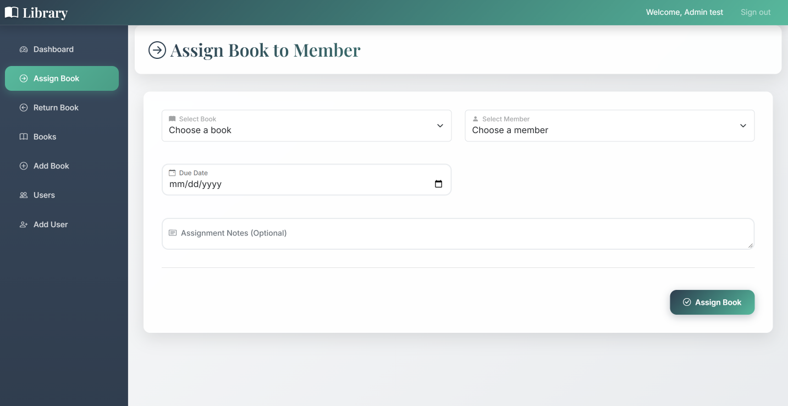
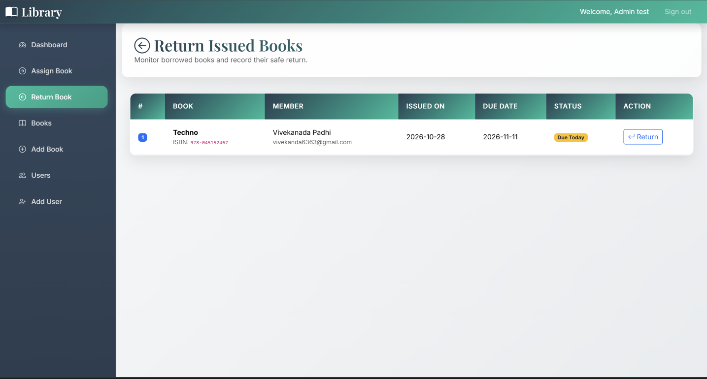
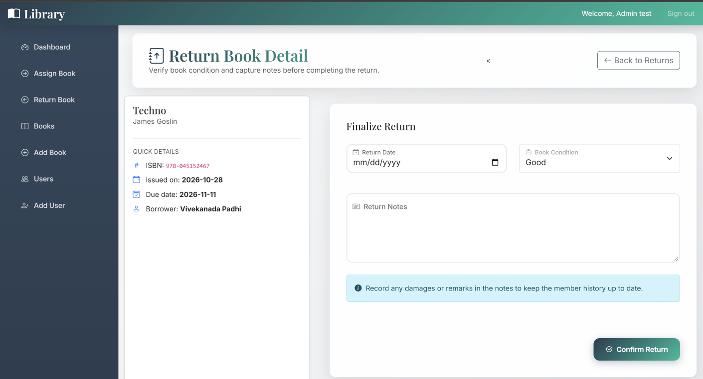

# Library Management System

A Java-based Library Management System developed to simplify library operations, manage book records, maintain member information, and handle book issue and return activities.

## Technologies Used

- Java
- JSP
- Servlets
- JDBC
- MySQL
- Apache Tomcat
- HTML
- CSS
- JS
## Key Features

- Book Management – Manage book records.
- Member Management – Maintain library member information.
- Book Issuing – Handle book issue operations.
- Book Returning – Manage book return operations.
- CRUD Operations – Create, read, update, and delete records.
- Database Connectivity – Perform database operations using JDBC and MySQL.

## Project Objective

To develop an organized and user-friendly library management application that simplifies book and member record management.

## Getting Started

1. Clone or download this repository.
2. Import the project into Eclipse or Spring Tool Suite.
3. Configure Apache Tomcat.
4. Configure MySQL database connectivity.
5. Add the required MySQL JDBC driver.
6. Run the application on the configured server.

## Developer

Suchismita Behera

B.Tech – Computer Science Engineering

GitHub: https://github.com/Suchismita7585

## Application Screenshots

### 1. Login Page

### 2. Dashboard

### 3. Book Management

### 4. Add Book

### 5. User Management

### 6. Add User

### 7. Assign Book

### 8. Return Book

### 9. Return Details

